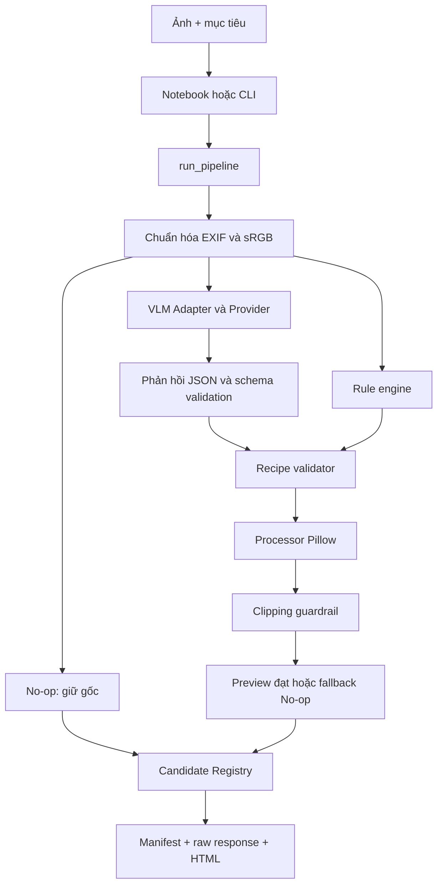

# Kiến trúc và workflow

## Cách tổ chức

Hiện tại là một ứng dụng Python theo module, chạy qua CLI hoặc notebook. `run_pipeline()` điều phối; VLM đề xuất công thức; Pillow thực thi; validator và clipping guardrail kiểm tra kết quả. Chưa tách microservices, API server hay database.



## Bản đồ module

| Module | Trách nhiệm |
|---|---|
| `cli.py` | CLI và `run_pipeline()`: tổ chức lượt chạy, gọi các module, xuất artifacts |
| `types.py` | Recipe, kết quả validation/processing, record và các giới hạn dùng chung |
| `vlm_adapter.py` | Request/response, schema, provider mock/replay/model thật, time budget |
| `validator.py` | Kiểm tra recipe, bounds, crop, cảnh báo requested/effective |
| `processor.py` | Chuẩn hóa ảnh, crop, chỉnh màu/sáng, đo clipping, fallback |
| `rule_engine.py` | Baseline từ thống kê luma, không dựa vào hiểu nội dung của VLM |
| `registry.py` | Lưu record từng candidate theo run/candidate ID |
| `html_report.py` | Tạo trang so sánh tĩnh để kiểm tra preview và xuất xứ |
| `prompts/` | Prompt và schema phản hồi VLM phiên bản v1 |

## Request và response của AI

Request chứa bytes ảnh upright sRGB, kích thước/hash ảnh model nhận, hash/kích thước file gốc, mục tiêu và phiên bản prompt. Model nhìn ảnh thực; pipeline hiện không thay ảnh bằng histogram hay chỉ một state số.

Response gồm:

- `analysis`: cỡ cảnh, chủ thể, nền, ánh sáng, điểm chưa chắc chắn.
- `keep_original`: có nên giữ gốc và lý do.
- `recommendations`: 0–2 option, mỗi option có tên, lý do, recipe.
- `retake_advice`: lời khuyên chụp lại riêng, có thể null.

Schema chặt chẽ: không nhận field lạ, số phải hữu hạn, option ID duy nhất. Response sai schema không được đưa thẳng vào processor.

## Recipe và thứ tự xử lý

```json
{
  "pipeline_version": "pipeline_v0",
  "exposure": 0.1,
  "contrast": 1.04,
  "saturation": 1.02,
  "crop": null
}
```

| Field | Ý nghĩa và giới hạn |
|---|---|
| `exposure` | Log2 hệ số Brightness trên sRGB đã mã hóa: `2**exposure`, trong [-1.5, 1.5]; không phải mô phỏng phơi sáng vật lý/RAW |
| `contrast` | Hệ số Pillow Contrast trong [0.7, 1.3] |
| `saturation` | Hệ số Pillow Color trong [0.8, 1.3] |
| `crop` | Null hoặc `[ymin, xmin, ymax, xmax]` chuẩn hóa trên ảnh upright |

Chuỗi cố định: EXIF transpose → ICC sang sRGB → RGB8 → crop → Brightness → Contrast → Color. Không dùng công thức HSV hoặc một công thức contrast khác thay cho Pillow.

Crop giữ ít nhất 30% diện tích và phải đáp ứng giới hạn kích thước. Chế độ bảo vệ toàn thân/bối cảnh phụ thuộc goal và bbox tin cậy theo validator; pipeline hiện chưa có detector cung cấp bbox. Không xem nhãn `full_body` do VLM trả về là bằng chứng có bảo vệ giải phẫu tự động.

Sau chỉnh, processor so clipping với input trên cùng crop. Khi tỷ lệ clipping tăng vượt ngưỡng 0.01, phương án quay về No-op và ghi lý do. Ảnh nhỏ có thể preview nhưng bị đánh dấu không đủ điều kiện export. Chi tiết quy tắc nằm trong source/tests.

## Ba provider

| Provider | Nguồn phản hồi | Giá trị kiểm chứng |
|---|---|---|
| Mock | Nội dung mẫu deterministic | Đường dữ liệu, xử lý lỗi, preview/report; không đánh giá AI |
| Replay | JSON phản hồi đã lưu | Tái lập, kiểm tra identity và giữ provenance gốc; không gọi model mới |
| Local Transformers | Qwen2.5-VL chạy trên GPU | Cần ảnh thật và runtime thực để đánh giá |

Model thật được lazy-load và tái sử dụng trên cùng provider. Mỗi lượt pipeline gọi provider một lần. Generation có max token và time budget cooperative theo bước sinh token; không cam kết ngắt một kernel CUDA đang treo.

## Kết quả và khả năng truy vết

Mỗi lượt có thư mục riêng, giữ các preview và `manifest.json`, `vlm_raw_response.json`, `index.html`. Registry ghi requested/effective recipe, source, trạng thái, hash, lý do reject/fallback và phiên bản. Bundle ghi model/prompt/schema/config/timings; replay giữ envelope của lượt gốc riêng.

Các phương án đối chứng No-op và rule luôn dùng cùng processor với AI để so sánh công bằng. Bốn preview trong báo cáo nghiên cứu không có nghĩa giao diện người dùng phải hiển thị bốn lựa chọn.

## Hướng mở rộng sau pilot

Điện thoại → API → pipeline hiện có → lưu artifacts → giao diện so sánh/chọn. Chỉ tách GPU worker khi nhu cầu chạy đồng thời chứng minh cần thiết. Preference logging/ranker là giai đoạn sau; không có trong bản hiện tại.
