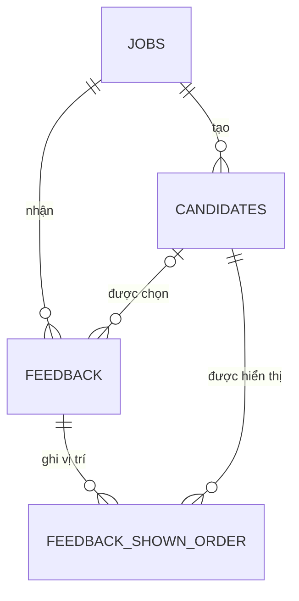
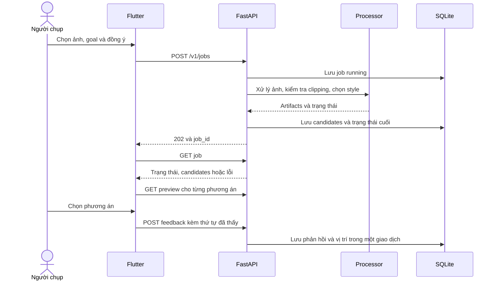

# Phân tích thiết kế hệ thống

Người chụp cung cấp ảnh và mục tiêu, quyết định giữ gốc hoặc chọn phong cách, có thể lưu ảnh và rút lại dữ liệu. Nhóm nghiên cứu đọc số liệu tổng hợp từ SQLite. Bản demo chạy trên máy cá nhân, một tiến trình API và storage cục bộ.

| Yêu cầu nghiệm thu | Thành phần kiểm tra | Bằng chứng |
|---|---|---|
| Ảnh JPEG/PNG, đồng ý trước khi gửi | Flutter và POST jobs | widget_test, test_upload_validation |
| Phương án gốc và các style đủ khác biệt | Guardrail, thumbnail Lab và selector | test_pipeline_feedback_and_research_report, test_style_selection |
| Xuất bản JPEG của phương án hợp lệ | GET preview, POST export | test_health_and_sync_job_lifecycle |
| Thứ tự chọn hợp lệ và xóa theo job | FeedbackInput, khóa ngoại SQLite và xóa storage | test_pipeline_feedback_and_research_report |
| Xem số liệu theo mục tiêu và vị trí | Báo cáo SQL chỉ đọc | test_pipeline_feedback_and_research_report |

**Quyết định kiến trúc.** Demo chạy xử lý đồng bộ trong worker của FastAPI để nhóm có thể khởi chạy bằng một lệnh. POST trả ID sau khi worker xử lý xong. Queue bền vững, xác thực nhiều người dùng và tự dọn job theo thời hạn là phần cần thiết trước khi mở dịch vụ cho nhiều người qua Internet. Kích thước upload giới hạn 15 MiB. Preview thu nhỏ tối đa 1024 px cạnh dài, còn export mã hóa JPEG từ artifact đã xử lý ở kích thước đầy đủ sau crop.
